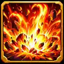

# Capture — Explosion de flammes et Tsunami (23 octobre 2026)

Deux icônes au **style laboratoire Combat / Monster Capture** finalisées depuis une paire dessinée et encadrée, composées pour des boutons carrés sur mobile. Aucun changement aux moteurs, compétences configurées ou personnages.

| Icône | Aperçu réel | Asset ID | Fichier WebP |
|---|---|---|---|
| Explosion de flammes |  | `pack:capture:icon-skill-explosion-flammes-01` | `icon_skill_explosion_flammes_01.webp` |
| Tsunami |  | `pack:capture:icon-skill-tsunami-01` | `icon_skill_tsunami_01.webp` |

- **Branche de départ** `global-assets@70acd71fbe3e5ff385d5afbc89605a7387648f64` ; checkpoint `checkpoint/global-assets-before-fire-explosion-tsunami-icons-2026-10-23` ; branche `work/global-assets-fire-explosion-tsunami-icons-2026-10-23`.
- **Vrais médias** : 2 WebP 128×128 RGB, des cadres dorés lisibles. Planche originale de deux images 887×887. Les sources PNG haute résolution sont livrées dans le ZIP de conversation, pas dans la bibliothèque runtime.
- **Catalogue** : `data/assets/catalog/global-visual-assets.v1.json` ; +2 icônes, deux IDs stables ; aucune auto-attribution aux compétences.
- **Traçabilité** : `assets/library/capture/icons/skills/capture_fire_explosion_tsunami_2026_10_23.provenance.json` et `tests/unit/capture-fire-explosion-tsunami-icons-2026-10-23.test.mjs`.
- **Charte pérenne du style** : `docs/LAB_CAPTURE_ICON_STYLE.md` : références réelles + format + règles de création.
- **Protégé** : `main`, `gh-pages`, `Zombicide-40k`, exploration, autres assets et gameplay.
- **Gates** : revue visuelle du contenu réel (locale), empreintes et dimensions, test de bout en bout de résolution catalogue→fichier, CI, diff limité, checkpoint puis publication. Prévisualisation dans ce document GitHub utilisant directement les vrais médias ; essai Android/en jeu à confirmer séparément.
