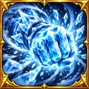
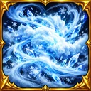
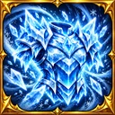
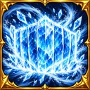

# Icônes Glace — quatre capacités Monster Capture (31 octobre 2026)

**Lot** : Poing de givre, Brouillard givrant, Armure de glace et Barrière de glace. Les quatre images sont les originaux illustrés de cette conversation, sans régénération ni substitution. Chaque média WebP est carré (128 × 128 px), palette glace bleue et cadre fantasy doré, adapté au sélecteur de compétences.

### Poing de givre

- Asset ID : `pack:capture:icon-skill-poing-de-givre-01`
- Média réel : `assets/library/capture/icons/skills/icon_skill_poing_de_givre_01.webp`
- SHA256 : `e0d5368c9b0ffa855e9c9ba5b4075247794205cca3fc403ddc800ced19ab3426`

### Brouillard givrant

- Asset ID : `pack:capture:icon-skill-brouillard-givrant-01`
- Média réel : `assets/library/capture/icons/skills/icon_skill_brouillard_givrant_01.webp`
- SHA256 : `0ac02e7fa3e43d1d68f47993496c9d1eb98927396c25350abb67cd1325057f2d`

### Armure de glace

- Asset ID : `pack:capture:icon-skill-armure-de-glace-01`
- Média réel : `assets/library/capture/icons/skills/icon_skill_armure_de_glace_01.webp`
- SHA256 : `2d57602163ce7c66d7d82e193817a2db65f08c143596a2b6749ac4358a083d5f`

### Barrière de glace

- Asset ID : `pack:capture:icon-skill-barriere-de-glace-01`
- Média réel : `assets/library/capture/icons/skills/icon_skill_barriere_de_glace_01.webp`
- SHA256 : `b98969839a0b9c635bbe96faf8d023543befde45db4a8341a8e40b0ed5055f6c`

## Processus et autorité

- **START** `checkpoint/lab-start-ice-skill-four-icons-2026-10-31` depuis `global-assets@b3764c86cbcc3472dcf4dba2bf67c28f7e8d1a17` ; lot `work/lab-ice-skill-four-icons-2026-10-31`.
- **Catalogue unique** : `data/assets/catalog/global-visual-assets.v1.json`. +4 IDs stables, icônes `category:skill`, `compatibility.uses` inclut `editor`.
- **Intégration** : le sélecteur de l'éditeur `gh-pages` existant lit le catalogue officiel et propose chaque `assetId`. Aucune mutation des compétences ou des loadouts, aucune affectation automatique.
- **Sources et previews** : archive `labo_combat_4_icones_glace_2026_10_31.zip` contenant les masters PNG 512px, les WebP 128px et la planche de prévisualisation. Les originaux 1254px restent dans la conversation. Provenance SHA `assets/library/capture/icons/skills/capture_ice_icons_2026_10_31.provenance.json`.
- **Gates** : TDD RED sur l'absence de média réel (GitHub Actions `41226973531`), ajout des quatre blobs réels et vérification à 128px via tests de contenu WebP/SHA/ID, CI complète sur SHA final, revue du diff et checkpoint GREEN avant publication fast-forward sous lease. Vérification réelle sur mobile distincte.
- **Protégés** : autres médias, sprites de glace, moteurs, éditeur, `main`, `gh-pages`, GenSrpg, Exploration et données auteur.
