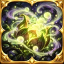
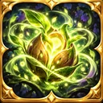
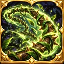

# Capture — trois icônes Nature : Spore soporifique, Graine de vie, Ronce (2026-10-29)

## Visuels réels (WebP runtime, 128 × 128)

### Spore soporifique

- **Identifiant** : `pack:capture:icon-skill-spore-soporifique-01`
- **Chemin officiel** : `assets/library/capture/icons/skills/icon_skill_spore_soporifique_01.webp`
- **SHA-256 du média** : `02a9aaa22d871a5b0c891104c675bb1aabf2bc43e8d28ceb2b3309dd3c87e559`

### Graine de vie

- **Identifiant** : `pack:capture:icon-skill-graine-de-vie-01`
- **Chemin officiel** : `assets/library/capture/icons/skills/icon_skill_graine_de_vie_01.webp`
- **SHA-256 du média** : `6756200d9d840c15fd0c5f8d42793b125cffe3560cf01fe6c3c10d5d9406a6e2`

### Ronce

- **Identifiant** : `pack:capture:icon-skill-ronce-01`
- **Chemin officiel** : `assets/library/capture/icons/skills/icon_skill_ronce_01.webp`
- **SHA-256 du média** : `690dd2ad2e3ca2b6136d5bd9d540a0cc718747444744ae021a87484c3ed5f9e4`

## Procédure et protections

- Sources : trois images d'origine 1254² créées dans ce fil le 29 octobre 2026, recadrage **aucun**, réduction LANCZOS sans remplacement graphique ; sources 512px, WebP runtime 128px et previews 48px distribués dans l'archive `icones_monster_capture_spore_vie_ronce.zip`.
- Source de vérité : branche `global-assets`, catalogue unique `data/assets/catalog/global-visual-assets.v1.json`. +3 entrées `assetType:icon`, `category:skill`, `compatibility.uses:['editor','combat','capture']`. Provenance `assets/library/capture/icons/skills/capture_nature_icons_2026_10_29.provenance.json`.
- Checkpoint de départ : `checkpoint/lab-start-nature-three-skill-icons-2026-10-29` sur `2bdc782aa256271f5dc4675a4f6da65faf74073b`. Travail : `work/lab-nature-three-skill-icons-2026-10-29`.
- Liaison éditeur : le sélecteur des icônes `data-skill-icon` sur `gh-pages` consomme directement les entrées du catalogue global via `hydrateAssetCatalog`. **Aucune attribution automatique** aux compétences configurées (le choix reste celui de l'auteur) ; aucun nouveau mécanisme ou propriété d'effet.
- Protections : aucun changement de `gh-pages`, `main`, GenSrpg, fiches auteur, compétences, animations, FX et icônes déjà publiées.
- Contrôles : le test sentinelle `tests/unit/capture-nature-three-icons-2026-10-29.test.mjs` a été introduit en RED avant les fichiers, puis vérifie catalogues/empreintes Git-SHA/SHA256/RIFF/WEBP/dimensions réelles ; CI GitHub requise, publication fast-forward sous lease. Preview dans GitHub sur les **vrais médias** ci-dessus ; test de rendu Android final reste distinct.
