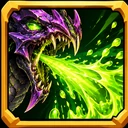
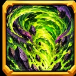
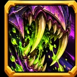
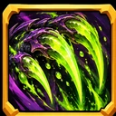
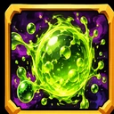

# Capture — cinq icônes Poison / Acide (24 octobre 2026)

## Contenu réel et emplacements

| Capacité | ID canonique | Image réelle |
|---|---|---|
| Crachat acide | `pack:capture:icon-skill-crachat-acide-01` |  |
| Tempête acide | `pack:capture:icon-skill-tempete-acide-01` |  |
| Morsure venimeuse | `pack:capture:icon-skill-morsure-venimeuse-01` |  |
| Croc de venin | `pack:capture:icon-skill-croc-de-venin-01` |  |
| Poison corrosif | `pack:capture:icon-skill-poison-corrosif-01` |  |

Ces 5 icônes sont des images **WebP RGB 128×128** issues de cinq PNG originaux **512×512** réalisés dans le style Monster Capture (vert acide / violet, cadre doré et silhouettes différenciées). Aucun placeholder, les fichiers WebP réels sont publiés sous `assets/library/capture/icons/skills/`.

- Source originale : archive `icons_poison_monster_capture_5.zip` fournie dans la conversation, SHA-256 `716898c701e6d6f08b779f467d40b9a1bf003ac3703379a039b1fad6822b2600`. PNG maîtres et preview inclus dans l'archive ; aucun doublon de bibliothèque.
- Base `global-assets@de162f32ee44e4a615b0df2d00c7df91cd1174a5`, checkpoint `checkpoint/global-assets-before-five-poison-icons-2026-10-24`, branche isolée `work/global-assets-five-poison-icons-2026-10-24`.
- Catalogue unique : `data/assets/catalog/global-visual-assets.v1.json` (+5 `assetType:icon`, `category:skill`, `compatibility.uses:editor`). Source : `global-assets`.
- Raccord éditeur : `src/ui/capture-editor-human-v2.js` sur `gh-pages` lit le catalogue officiel avec `cache:no-store` via `hydrateAssetCatalog`, utilise `captureEditorAssetMatchesRoleV1(asset,'icon')`, puis `populateSelect` pour `data-skill-icon`. Les cinq nouveaux identifiants deviennent **sélectionnables** sans modifier le code ni maintenir un second registre. Le sélecteur prévisualise `globalVisualAssetUrl(asset.resource.file)` pour le contenu réel.
- L'utilisateur conserve ses capacités configurées et doit sélectionner l'icône souhaitée dans chacune, puis enregistrer pour la lier à la capacité : aucune auto-affectation par nom et aucune altération de `configuredSkills` ou des loadouts.
- Provenance/contrôles : `assets/library/capture/icons/skills/capture_poison_icons_2026_10_24.provenance.json`, `tests/unit/capture-poison-skill-icons-2026-10-24.test.mjs`. Vérif de l'empreinte réelle SHA-256/Git blob, RIFF/WEBP, dimensions, unicité des IDs et référence catalogue.
- Protégés : toutes les autres icônes et FX, les aptitudes, l'éditeur et le runtime, `main`, `gh-pages`, `Zombicide-40k` et Exploration.
- **Limite de validation** : CI + publication garantissent la disponibilité dans la bibliothèque mais ne constituent pas un essai visuel réel sur smartphone ; cette étape reste à valider par l'auteur.
