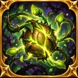

# Graine sangsue — icône Monster Capture (28 octobre 2026)

## Icône finale — vrai fichier de bibliothèque

- **ID canonique** : `pack:capture:icon-skill-graine-sangsue-01`.
- **Fichier physique** : `assets/library/capture/icons/skills/icon_skill_graine_sangsue_01.webp`.
- **Format** : WebP opaque (128 × 128), cadre fantasy doré, graine végétale avec bourgeons et lianes lumineuses ; source créée dans ce fil et inspectée en preview à 128 px et 48 px.
- **Source** : `graine_parasite_enchantée_aux_lianes_dorées.png` (1254²), empreintes de provenance dans `assets/library/capture/icons/skills/capture_graine_sangsue_2026_10_28.provenance.json`. ZIP local contient source PNG 512² et previews 128/48, pas de second catalogue.
- **Base / propriétaire** : `global-assets@4b72ab532e79a23ba278bf3213c044d94d400409`, branche `work/lab-graine-sangsue-icon-2026-10-28`, checkpoint `checkpoint/lab-start-graine-sangsue-icon-2026-10-28`.
- **Catalogue unique** : `data/assets/catalog/global-visual-assets.v1.json` ; une seule entrée nouvelle, plus 1 asset et 1 icône. L'ancienne icône `Sangsue` reste inchangée.
- **Raccord éditeur** : le sélecteur des icônes de capacité du labo (`data-skill-icon`) est déjà alimenté par `hydrateAssetCatalog` depuis `global-assets` et filtre les `assetType:icon` marqués `editor`. L'assetId ci-dessus sera sélectionnable sans modification du code de l'éditeur ni des fiches auteurs.
- **Pas de liaison automatique à une capacité** : sélectionner l'icône dans la fiche souhaitée puis enregistrer l'édition pour la lier explicitement.
- **Test** : `tests/unit/capture-graine-sangsue-icon-2026-10-28.test.mjs`, contrôle des vrais médias, empreintes, dimensions, comptage et unicité du catalogue. CI au SHA final exigée ; inspection mobile réelle distincte.
- **Hors périmètre** : icônes déjà présentes, sprites, compétences, marqueurs, fiches auteur, moteurs, `main`, `gh-pages`, GenSrpG, exploration.
