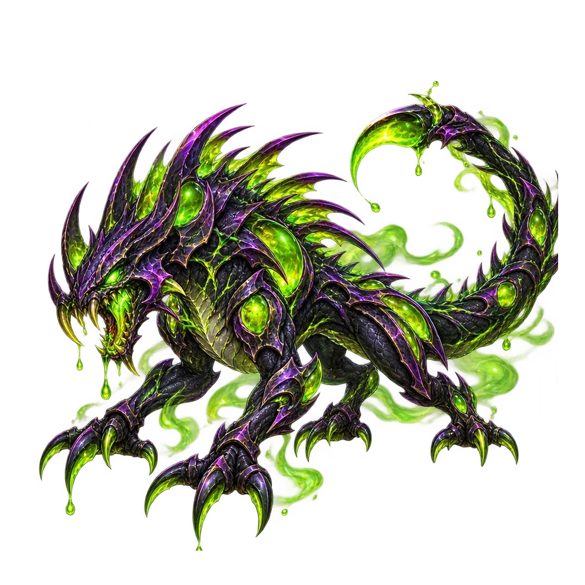
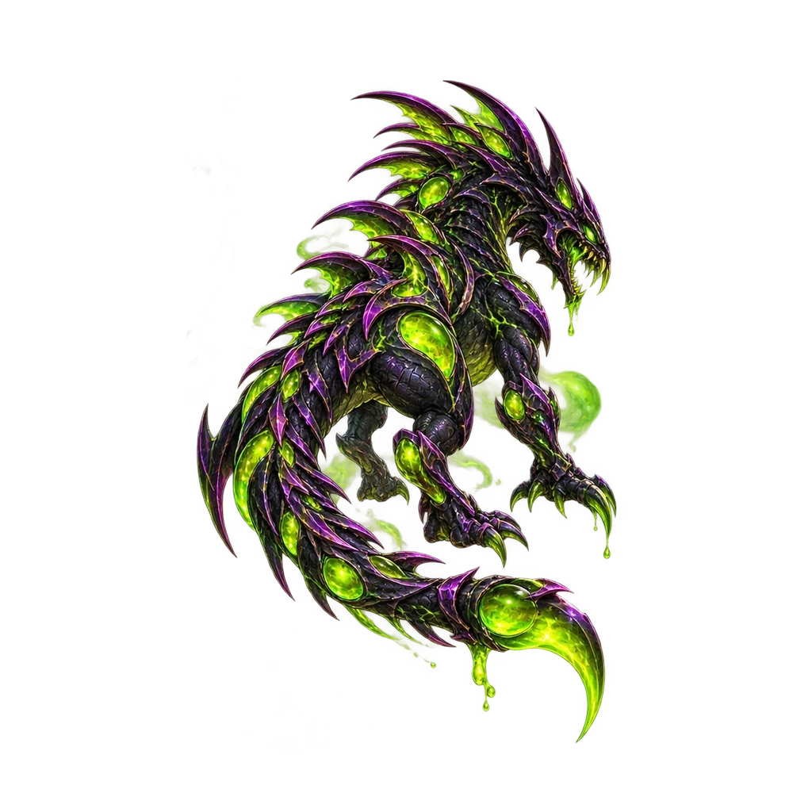

# Venombre — remplacement des deux modèles (24 octobre 2026)

Deux vues existantes ont été **remplacées à l'identique de leurs identifiants et chemins** dans la bibliothèque `global-assets`, sans créer d'autres propriétaires :

- **Face / adversaire** : `assets/library/capture/creatures/venombre/runtime/venombre_opponent.webp`, `pack:capture:creature-venombre-opponent-01` ; modèle approuvé épuré, sans vapeurs de poison.
- **Dos / joueur** : `assets/library/capture/creatures/venombre/runtime/venombre_player.webp`, `pack:capture:creature-venombre-player-01` ; modèle approuvé avec queue au-dessus de la jambe, posture et palette conservées.

Prévisualisation des **vrais fichiers WebP publiés** :

 

Base officielle `global-assets@40efba68f2d24f1b8fb81876516a52143ae87d2e`, checkpoint `checkpoint/global-assets-before-venombre-visual-refresh-2026-10-24`, branche `work/global-assets-venombre-visual-refresh-2026-10-24`.

Deux vraies images WebP transparentes **1024 × 1024** extraites des deux générations originales validées (PNG 1254 × 1254), alpha non trivial, fonds noirs retirés, vides importants de la queue préservés. Chaîne : source ChatGPT -> détourage local -> WebP réels -> Git blobs vérifiés -> fichiers runtime canoniques -> catalogue existant. Empreintes des sources et octets réels : `assets/library/capture/creatures/venombre/venombre_visual_refresh_2026_10_24.provenance.json`.

**Protégés et inchangés** : `venombre_icon.webp`, `venombre.meta.json` (profil/offsets/scales/anchors), trois IDs du catalogue, compétences, gameplay, loadouts, UI, autres créatures, `main`, `gh-pages` et GenSrpG principal. Aucun ajustement automatique des ombres ou des sockets à partir de la nouvelle silhouette.

Gates : test réel WebP alpha, dimensions, SHA256, Git blob, unicité des ID catalogue, invariants meta et icône, CI GitHub, revue de diff et publication sécurisée vers `global-assets`. La validation en jeu mobile est distincte de la disponibilité des médias en bibliothèque.
